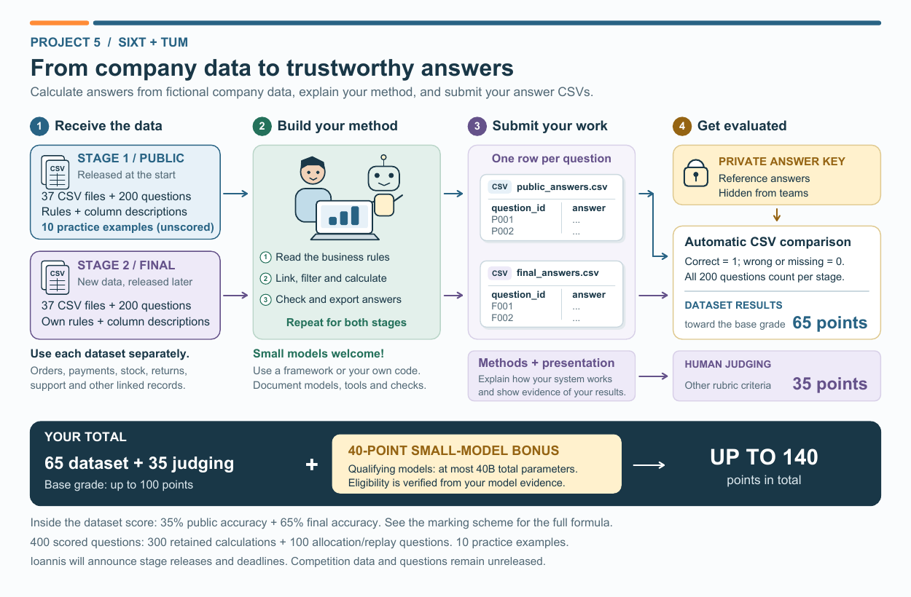
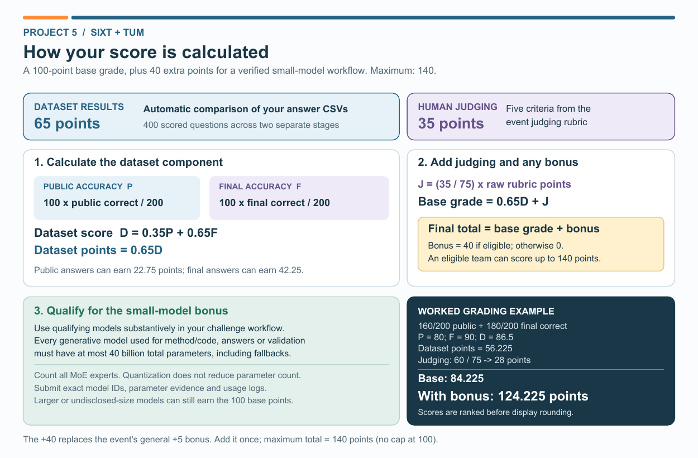

# Project 5: SIXT + TUM

**Stage 1 is available now - 13 November 2026.**

**[Download the Stage 1 student dataset ZIP](releases/problem7_student_start.zip?raw=true)** | [SHA-256 checksum](releases/problem7_student_start.zip.sha256)

Dataset version **7.0.0**: **37 CSV tables, 200 scored questions and 10 unscored practice examples with answer values**. The ZIP includes business rules, column descriptions, a blank answer CSV, a format checker and report/model-use templates.

Extract the ZIP and read `README.md`, `EVENT_RULES.md`, `business_rules.md` and `HARD_TASK_RULES.md`. Calculate the answers to `public_leaderboard_questions.csv` using this package's `datasets/` folder, then fill `public_answers.csv` with exactly `question_id,answer`. Submit it as `Project_5/public_answers.csv` through the channel and by the cutoff announced by the organizers. The checker tests file format, not answer correctness.

**Stage 2 will be released separately after Stage 1 submissions are locked.** This announcement authorizes Stage 1; preparation-time "local only" or "awaiting authorization" notices inside the unchanged ZIP are superseded for this stage.

The base grade is **65 points for dataset answers + 35 points for methods and presentation**. A verified qualifying small-model workflow earns **40 additional points**, for a maximum of **140**. Read `EVENT_RULES.md` for the complete criteria, model-size requirements and report submission process. Coordinate the report's arXiv upload with the organizers.

[Six-slide introductory guide](STUDENT_GUIDE.pdf) | [Three solved toy examples](examples/README.md)

The introductory visuals describe both stages; the Stage 1 release notice above takes precedence over their pre-event release wording.

Contact: **Ioannis Tzachristas** | [Email](mailto:ioannis.tzachristas@tum.de) | [LinkedIn](https://www.linkedin.com/in/ioannis-tzachristas-83a00522a/)
